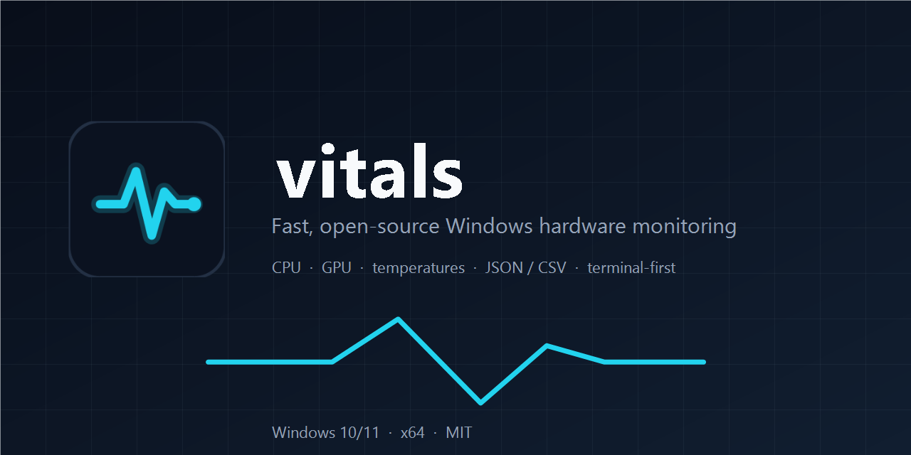

# vitals

[](https://github.com/KingStan0/vitals/actions/workflows/ci.yml)
[](https://github.com/KingStan0/vitals/releases/latest)



A fast, open-source hardware monitor for Windows, built for the terminal. One
small binary gives you a live dashboard, one-shot JSON snapshots, streaming
NDJSON, CSV recording, and a raw sensor dump you can attach to bug reports.

**[Download for Windows x64](https://github.com/KingStan0/vitals/releases/latest)**
— no .NET required.

- **Live TUI** with CPU, per-core load, GPU, memory, per-volume disk usage,
  disk/network throughput, temperatures, fans and top processes.
- **Scriptable**: `snapshot --json`, `watch --json`, `export` to CSV.
- **Multi-GPU aware**: all adapters are exported in JSON; the dashboard shows
  the primary (largest / most capable) GPU.
- **Driver-aware, not driver-bundling**: detects PawnIO and can install the
  official signed driver on request. It is never bundled; the opt-in setup
  downloads it from GitHub and verifies its SHA-256.
- **No telemetry.** The only outbound request is the opt-in PawnIO setup
  download; sensor data stays on your machine.
- **Small and efficient**: one sampling thread, no per-widget polling, and a
  single-file self-contained publish.

## Install (no .NET required)

1. Open the [latest release](https://github.com/KingStan0/vitals/releases/latest)
   and download `vitals-<version>-win-x64.zip`.
2. Extract it anywhere, for example `%LOCALAPPDATA%\vitals`. Do not run it from
   inside the zip. The zip contains `vitals.exe`, `vitals.cmd`, this README,
   `CHANGELOG.md`, `LICENSE`, `THIRD-PARTY-NOTICES.md`, full dependency license
   texts in `licenses/`, `config.example.json`, the JSON schema under `docs/`,
   and the icon/banner assets.
3. Optional: run `vitals setup` (or accept the first-launch prompt) to install
   [PawnIO](https://pawnio.eu) if you want CPU package and motherboard
   temperatures/power. It downloads the installer, so it needs internet access.
   `vitals` works without it.
4. Double-click `vitals.cmd`, or open a terminal in that folder:

```powershell
.\vitals.cmd                  # dashboard; asks for admin via UAC
.\vitals.exe snapshot --json  # scripted, no elevation needed
```

`vitals.cmd` requests administrator rights for the interactive dashboard and
for `vitals setup`. Headless commands (`snapshot`, `watch`, `export`, `sensors`,
`setup --check`, `--render-once`, `--help`, `--version`) stay in the current
console so pipes and redirects keep working, even when options come before the
command.
Running `vitals.exe` directly still gives you CPU load, GPU, memory, disks,
network and usually GPU temperatures, with missing readings shown as `n/a`.

### Verifying a release

Each release publishes a versioned zip and a matching `.sha256` file, plus a
signed build-provenance attestation. From the folder containing the download:

```powershell
$zip = Get-ChildItem .\vitals-*-win-x64.zip | Select-Object -First 1
Get-FileHash $zip.FullName -Algorithm SHA256
Get-Content "$($zip.FullName).sha256"

# Requires the GitHub CLI: https://cli.github.com
gh attestation verify $zip.FullName --repo KingStan0/vitals
```

The binary is not code-signed, so Windows SmartScreen may show "Windows
protected your PC". Choose **More info → Run anyway**, or build from source.
Some antivirus products also flag tools that read hardware sensors; the full
source is in this repository.

## Dashboard

```text
DESKTOP-GGRKBQ6  ·  AMD Ryzen 5 5600G with Radeon Graphics  ·  RX 5700  ·  Windows 11 Pro 26H2 (26300)  ·  up 0d 01h 18m
live
board Micro-Star International Co., Ltd. B450M-A PRO MAX II (MS-7C52)  ·  sampling 1000 ms
╭─CPU──────────────────────────────────────────────────────────────╮  ╭─GPU───────────────────────────────────────────╮
│  21%  ███░░░░░░░░░░░░░                   █                       │  │   7%  █░░░░░░░░░░░░░░░               █        │
│ temp 60°C   pkg 23 W   clock 3789 MHz   peak 21%                 │  │ edge 42°C   hot 42°C   vram 42°C              │
│ c0 █████ 100%  c1 ██░░░  50%  c2 ░░░░░   0%  c3 ██░░░  50%       │  │ 11 W   55 MHz   0.7/8.0 GB   fan 22% 1045 rpm │
│ c4 ░░░░░   0%  c5 ░░░░░   0%  c6 ░░░░░   0%  c7 ░░░░░   0%       │  ╰───────────────────────────────────────────────╯
│ c8 ░░░░░   0%  c9 ░░░░░   0%  c10 ░░░░░   0%  c11 ██░░░  50%     │  ╭─TEMPS─────────────────────────────────────────╮
╰──────────────────────────────────────────────────────────────────╯  │ cpu 60°              gpu 42°                  │
╭─MEMORY───────────────────────────────────────────────────────────╮  │ hot 42°              vram 42°                 │
│  31%  █████░░░░░░░░░░░  7.4 GB / 23.9 GB                         │  │ System 41°           VRM MOS 81°              │
│ commit 8.8 GB / 31.1 GB   cache 13.1 GB                  █       │  │ PCH 83°              CPU Socket 39°           │
╰──────────────────────────────────────────────────────────────────╯  │ PCIe x1 80°          TEAM TM8FP… 44°          │
╭─DISK / NET───────────────────────────────────────────────────────╮  ╰───────────────────────────────────────────────╯
│ C: ███░░░░░░░  29% 138.5 GB / 475.9 GB                           │  ╭─PROCESSES by CPU──────────────────────────────╮
│ D: ████░░░░░░  40% 44.4 GB / 111.8 GB                            │  │ vitals                     2.5%   78.0 MB     │
│ E: ████░░░░░░  37% 342.3 GB / 931.5 GB                           │  │ Discord                    1.5%  774.9 MB     │
│ disk R 0 B/s  W 0 B/s                                            │  │ dwm                        0.5%  103.9 MB     │
│ net  ↓ 20.1 KB/s  ↑ 27.2 KB/s                                    │  │ brave                      0.0%  568.1 MB     │
╰──────────────────────────────────────────────────────────────────╯  │ opencode                   0.0%  359.2 MB     │
                                                                      │ MsMpEng                    0.0%  356.4 MB     │
                                                                      │ opencode                   0.0%  332.3 MB     │
                                                                      │ explorer                   0.0%  317.2 MB     │
                                                                      ╰───────────────────────────────────────────────╯
q quit   space pause   r peaks   s sort   t theme   e export   [ ] interval   interval 1000 ms
```

(Blank rows at the bottom of a tall terminal are trimmed here.)

## Requirements

- Windows 10 1809+ or Windows 11, x64.
- [Windows Terminal](https://aka.ms/terminal) recommended for Unicode box
  drawing and true colour.
- To build: the [.NET 10 SDK](https://dot.net) (10.0.402 or newer).
- Optional, for CPU and motherboard temperatures/power: a signed
  [PawnIO](https://pawnio.eu) installation. `vitals setup` downloads the official
  installer on request (internet access required) and verifies its SHA-256; it
  is never bundled.

GPU sensors come from LibreHardwareMonitor and usually work without PawnIO.
Disk throughput needs an elevated process; CPU/motherboard sensors do too.

## Build from source

Requires the [.NET 10 SDK](https://dot.net). The repository pins SDK 10.0.402
in `global.json`.

```powershell
git clone https://github.com/KingStan0/vitals.git vitals
cd vitals
dotnet build -c Release
dotnet run --project src/Vitals -- snapshot
```

Build a standalone `dist\vitals.exe` (no .NET install required on the target):

```powershell
pwsh -File scripts/publish.ps1
.\dist\vitals.exe snapshot --json
```

Build the release zip locally:

```powershell
pwsh -File scripts/package.ps1 -Version dev
```

For the interactive dashboard from a source build, run `vitals.cmd`. It checks
for a release exe, a published `dist` build, or a Release/Debug build, then
relaunches through UAC only when the current console is not elevated.

```powershell
.\vitals.cmd
```

You can also run `dist\vitals.exe` directly from an elevated terminal.

## Commands

```text
vitals                       live TUI dashboard
vitals snapshot              one human-readable reading
vitals snapshot --json       one JSON document
vitals watch                 periodic one-line summaries
vitals watch --json          newline-delimited JSON (NDJSON), one object per tick
vitals watch -d 30s          stop after 30 seconds
vitals watch --out run.ndjson  write the stream to a file
vitals export                record CSV until Ctrl+C (auto-named file)
vitals export --out run.csv  record to a specific file
vitals sensors               every raw sensor LHM exposes
vitals sensors --json        raw sensor array, useful in bug reports
vitals setup                 install PawnIO, then start the dashboard
vitals setup --check         report whether PawnIO is installed
vitals setup --no-start      install only; do not start the dashboard
vitals --version             print the version and exit
vitals --help
```

Options:

```text
-i, --interval <ms>    sampling interval for TUI/watch/export, default 1000 (250–60000)
-d, --duration <time>  stop after 30s / 10m / 1h (watch, export)
-o, --out <path>       output path (watch, export)
-c, --config <path>    config file, default %APPDATA%\vitals\config.json
    --json             machine-readable output (snapshot, watch, sensors)
    --no-driver        skip LibreHardwareMonitor entirely
    --ascii            ASCII-only glyphs (TUI and human-readable output)
    --no-color         disable colour
    --render-once      render one dashboard frame and exit (testing)
    --yes              assume yes for setup prompts
    --no-start         install only; do not start the dashboard (setup)
    --check            report whether PawnIO is installed (setup)
    --force            reinstall or upgrade PawnIO (setup)
    --debug            verbose errors
    --version          print the version and exit
-h, --help
```

`--help` and `--version` are terminal actions: when present they print and exit
successfully even if another option is invalid.

Exit codes are `0` for success, `1` for a runtime failure and `2` for invalid
arguments. `vitals setup --check` exits `0` when PawnIO is installed and `1`
when it is missing.

### TUI keys

| Key | Action |
|---|---|
| `q` / `Esc` | quit |
| `Space` | pause/resume sampling |
| `r` | reset CPU peak |
| `s` | cycle process sort (CPU → memory → name) |
| `t` | cycle theme (default → amber → mono) |
| `e` | export the current session to CSV |
| `[` / `]` | slower / faster refresh |

## Permissions and PawnIO

`vitals.exe` is manifested `asInvoker` so `snapshot --json` and other scripted
commands work without elevation. Windows does not allow a single manifest to
elevate only sometimes, so the dashboard is started through `vitals.cmd`, which
requests UAC when necessary.

Without elevation or PawnIO you still get:

- CPU load and per-core load
- GPU load, clocks, fans, VRAM and usually temperatures
- memory, volumes, disk and network throughput

You will not get CPU package temperature/power or NCT6687D motherboard sensors.
Missing readings are rendered as `n/a`, never as a fake `0`.

PawnIO is a separate, signed kernel driver used by LibreHardwareMonitor. Run
`vitals setup` to install it, or accept the first-launch prompt in an elevated
dashboard. `vitals setup` downloads the official installer from GitHub, verifies
its pinned SHA-256, and runs it silently with administrator rights. It never
bundles the installer, never installs without consent, and never restarts
Windows automatically. If the installer reports that a restart is required,
`vitals` tells you and leaves the decision to you.

`vitals setup --check` reports the current state without elevation or changes.
Headless commands (`snapshot`, `watch`, `export`, `sensors`) never prompt for or
install PawnIO. Set `"promptForPawnIo": false` in the config to suppress the
first-launch prompt; `--no-driver` and `--render-once` also skip it.

For unattended installs, use `vitals setup --yes --no-start`. `--yes` skips the
consent prompt, so only use it in automation you control.

## Configuration

Create `%APPDATA%\vitals\config.json` (or pass `--config`). Missing fields fall
back to defaults. Invalid values are clamped.

```json
{
  "intervalMs": 1000,
  "processIntervalMs": 2000,
  "processCount": 8,
  "historySeconds": 300,
  "ascii": false,
  "promptForPawnIo": true,
  "theme": "default",
  "thresholds": {
    "cpuTemp": { "warn": 85, "crit": 95 },
    "gpuEdge": { "warn": 80, "crit": 90 },
    "gpuHotspot": { "warn": 95, "crit": 105 },
    "gpuMemory": { "warn": 90, "crit": 100 },
    "memory": { "warn": 85, "crit": 95 }
  }
}
```

The dashboard adapts below 100 columns by stacking panels in a single column.
`--ascii` is there for consoles that cannot render the Unicode gauges.

- `intervalMs` — sampling interval in milliseconds (250–60000).
- `processIntervalMs` — how often the process list is refreshed (250–60000).
  Between refreshes the last list is reused, so JSON and the dashboard may show
  a process percentage that is up to this old.
- `processCount` — rows in the processes panel and entries in the JSON
  `processes` array (3–64). The dashboard sorts the full process list, so the
  memory and name views are not limited to the busiest processes.
- `historySeconds` — seconds of samples kept for the TUI's in-memory `e`
  export (30–86400). The export buffer holds only timestamps and raw readings,
  and is capped at 6,000 frames so an extreme setting cannot exhaust memory.
  Sparklines always retain the most recent 300 samples.
- `ascii` and `theme` — dashboard defaults; `--ascii` and the `t` key override
  them for the current run.
- `promptForPawnIo` — show the first-launch PawnIO install prompt in an
  elevated dashboard (default `true`). It never affects headless commands.
- `thresholds` — `warn`/`crit` values used for colours; each is clamped to
  0–200 and `crit` is kept at or above `warn`.

## Output formats

### JSON snapshot

`vitals snapshot --json` emits one camelCase object. Values that the hardware or
driver cannot provide are `null`; no zero-filled placeholders. Sensor noise is
rounded to the precision the dashboard uses (temperatures and power to 0.1,
clocks and bytes to whole numbers, process CPU to 0.01). The example below is
abridged: arrays have more entries and `memory` also includes derived fields
such as `usedBytes`, `usedPercent` and `commitBytes`.

```json
{
  "timestamp": "2026-10-21T12:34:56.789+02:00",
  "cpuLoadPercent": 21.3,
  "cpuTempC": 60.2,
  "cpuPowerW": 23.4,
  "cpuClockMhz": 3789,
  "cores": [ { "index": 0, "loadPercent": 100, "clockMhz": 4650, "tempC": null } ],
  "gpu": {
    "name": "RX 5700",
    "loadPercent": 7,
    "edgeC": 42,
    "hotspotC": 42,
    "memoryTempC": 42,
    "fanRpm": 1045,
    "fanPercent": 22,
    "powerW": 11,
    "clockMhz": 55,
    "memoryClockMhz": 716,
    "memoryUsedBytes": 773849088,
    "memoryTotalBytes": 8573157376
  },
  "gpus": [
    {
      "name": "RX 5700",
      "loadPercent": 7,
      "edgeC": 42,
      "hotspotC": 42,
      "memoryTempC": 42,
      "fanRpm": 1045,
      "fanPercent": 22,
      "powerW": 11,
      "clockMhz": 55,
      "memoryClockMhz": 716,
      "memoryUsedBytes": 773849088,
      "memoryTotalBytes": 8573157376
    }
  ],
  "memory": { "totalBytes": 25606051430, "availableBytes": 18100000000 },
  "volumes": [ { "name": "C:", "label": "System", "totalBytes": 511000000000, "freeBytes": 365000000000 } ],
  "diskReadBytesPerSecond": 0,
  "diskWriteBytesPerSecond": 40960,
  "netReceiveBytesPerSecond": 20582,
  "netSendBytesPerSecond": 27852,
  "processes": [ { "pid": 8636, "name": "Discord", "cpuPercent": 1.5, "workingSetBytes": 812000000 } ],
  "temps": [ { "label": "VRM MOS", "celsius": 81.5, "group": "board" } ],
  "readings": [ { "id": "/amdcpu/0/load/0", "source": "lhm", "hardware": "AMD Ryzen 5 5600G", "name": "CPU Total", "kind": "Load", "value": 21.3, "unit": "%" } ],
  "status": { "elevated": true, "lhmAvailable": true, "lhmError": null, "pawnIoInstalled": true, "notes": [], "appVersion": "0.2.0" }
}
```

`gpu` is the primary adapter (the one shown in the dashboard) and is emitted for
backward compatibility. `gpus` contains every adapter LibreHardwareMonitor
exposes, so hybrid laptops and multi-GPU desktops can read each device. If no
adapter is found, `gpu` is `null` and `gpus` is an empty array.

The machine-readable schema is in
[`docs/schema/snapshot.schema.json`](docs/schema/snapshot.schema.json).

`watch --json` prints the same shape as compact single-line objects, suitable
for `jq`, log shippers, or an agent tailing the stream.

### CSV

CSV output is long-format, one sensor reading per row:

```csv
timestamp,id,source,hardware,name,kind,value,unit
2026-10-21T12:34:56.7890000+02:00,/amdcpu/0/load/0,lhm,AMD Ryzen 5 5600G,CPU Total,Load,21.3,%
```

`vitals export` writes to `vitals-YYYYMMDD-HHmmss.csv` in the current directory
unless `--out` is given. The TUI's `e` key exports the session held in memory.
Files are UTF-8 with a BOM so Excel detects the encoding; text fields that start
with a spreadsheet formula character are prefixed with an apostrophe.

## How it works

- `ISensorSource` implementations: `LhmSource` for CPU/GPU/board/storage/fans
  and `WinSource` for load, memory, volume disk throughput and network. ADLX is
  a possible future source; it is not implemented.
- One `SampleEngine` owns the sources. A background `Sampler` thread produces
  immutable `Snapshot` objects; the UI thread only renders `Sampler.Latest`.
  Slow sensor reads never block the keyboard or rendering.
- `History` keeps a fixed ring of recent samples for sparklines and peaks.
- Curated values are selected by LHM sensor name (for example `CPU Core #N`);
  array position is never used. Raw readings keep LHM's stable `Identifier` in
  `readings[].id`. See `docs/sensors/` for the maps used on real hardware.
- Disk throughput uses `IOCTL_DISK_PERFORMANCE` on volume handles. On the
  development machine, the same IOCTL on `\\.\PhysicalDriveN` returns frozen
  counters, so volumes are the reliable source.
- Network totals prefer physical adapters and fall back to virtual ones when
  they are the only active path (for example inside a VM), so VPN/Hyper-V
  adapters cannot double count the same traffic.
- Drive and adapter topology is cached for 30 seconds; free space and byte
  counters are still read every sample.

## Performance

Sampling is O(sensors) at 1 Hz. There are no timers or polling loops per widget,
and no allocations for colour markup beyond the rendered frame. From a source
checkout, measure one-shot latency on your machine:

```powershell
pwsh -File scripts/bench.ps1
```

The benchmark reports min/avg/p95/max for a full snapshot including process
enumeration. For steady-state CPU and memory use, run:

```powershell
pwsh -File scripts/soak.ps1 -Seconds 60
pwsh -File scripts/soak.ps1 -Seconds 60 -Mode tui   # opens a console window
```

The headless mode measures the same sampler used by the dashboard. The TUI mode
includes rendering, but it is stopped with `Stop-Process`, so shutdown cost is
not included. On the development machine (Ryzen 5 5600G, Windows 11), a 10-second
headless run averaged about 0.4% of the machine (5% of one core) and 36 MB
working set at 1 Hz, including process startup; measure your own hardware before
optimizing for it. One-shot `snapshot` latency is dominated by the first
LibreHardwareMonitor update (about 2–3 seconds); `--no-driver` completes in well
under a second.

## Development

```powershell
dotnet build
dotnet test
dotnet run --project src/Vitals -- --render-once
```

The test project uses xUnit and Spectre.Console.Testing to render the dashboard
at fixed sizes. Sensor values are hardware-dependent; tests use fixtures, while
`docs/sensors/` documents the real dumps the mappings were built against.

See [CONTRIBUTING.md](CONTRIBUTING.md) for setup and review expectations, and
[CHANGELOG.md](CHANGELOG.md) for release history.

Layout of the repo:

```text
src/Vitals/
  Cli/          argument parsing and headless commands
  Config/       config load, defaults, thresholds
  Export/       CSV writer
  Sampling/     sample engine, background sampler, history ring
  Sensors/      LHM and Win32 sources, P/Invoke, models
  Ui/           dashboard widgets, TUI loop, theme, formatting
src/Vitals.Tests/
scripts/        publish, package, smoke, benchmark and soak helpers
docs/sensors/   real sensor maps for specific hardware
docs/           troubleshooting and JSON schema
```

Adding support for a new board or GPU usually means documenting the LHM
identifiers and, if needed, adjusting the lookup preferences. Include your
`vitals sensors --json` output in an issue.

## Troubleshooting

Common fixes for SmartScreen, missing temperatures, PawnIO, stale sensors and
unsupported hardware are in [docs/troubleshooting.md](docs/troubleshooting.md).
If that does not help, open an issue with `vitals --version` and the output of
`vitals sensors --json` (redact anything you consider private).

## License

MIT. See [LICENSE](LICENSE). Third-party notices are in
[THIRD-PARTY-NOTICES.md](THIRD-PARTY-NOTICES.md); the release zip also contains
the full texts under `licenses/`.
